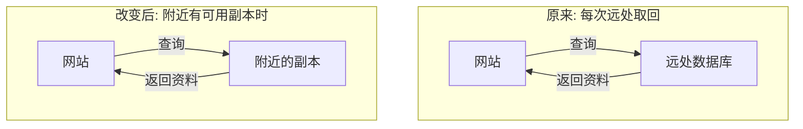

# 报告模板

按以下顺序输出, 用一个具体场景或研究问题串起问题, 方法, 证据与边界, 前后分别提供直观概览和阅读建议. 默认以图为主, 短文补充, 按 skill 入口的图文讲解规则选择表达方式. 让图承担流程, 结构和对比的解释, 正文补足背景, 原因和条件, 不逐节点复述. 报告使用简体中文, 不把每节写成一串术语或字段, 不要求每节配图或固定图数. 列表用于并列事项或步骤, 不限制句数和篇幅, 以解释清楚为准.

## 报告开头

```text
# 论文第一遍阅读 (Paper Snapshot)

**论文:** 原标题, 必要时附通俗的中文释义.
**作者与发表信息:** 仅填写能够可靠确认的作者, 年份和发表处, 缺失项注明未确认.
**论文类型:** 用中文说明, 例如提出方法, 理论研究, 综述, 评测或数据集.
**来源与阅读范围:** 论文链接或用户提供的文件, 实际读取的章节或材料范围.
```

只有摘要或部分内容时, 在开头明确本报告只能作初步理解, 哪些判断仍缺材料. 下方各部分只讲已读内容支持的事项, 没有依据时说明缺口, 不用常识填成论文结论.

## 直观概览

用一小段日常语言建立全貌: 这篇论文关心什么困难, 大致采用什么办法, 已读内容支持怎样的结果或认识. 不在此处罗列技术组件和贡献清单; 读者尚未看到后文的术语解释, 应先讲实际改变了什么, 而不是先报技术名称. 不要求压成一句话.

整体关系需要图才能清楚时在此展示总览图, 后文只展开关键变化, 不重复画同一全貌. 简短文字已经足够时不加装饰性总览图.

## 问题: 到底遇到了什么困难?

从具体的人, 系统或研究疑问出发, 说明想完成什么, 原来怎么做, 卡在哪里, 为什么值得解决. 避免只把论文标题翻译一遍, 或用"效率与安全难以兼顾"代替具体困难.

+ 采用论文案例时附真实定位. 自拟场景先标明"举个便于理解的假设例子", 不让读者误以为它是论文实际研究过的应用.
+ 介绍旧办法只为解释困难, 不展开完整文献综述. 作者对旧办法的批评用"作者认为"等措辞标明归属.
+ 旧办法的步骤或瓶颈适合图示时直接画出, 用短文点明卡在哪里及其影响, 不再完整叙述图中流程.
+ 理论或综述论文可以从具体疑问切入, 不必虚构用户或应用系统.

## 方法: 作者想到了什么办法?

接着前面的场景, 说明原来怎样做, 作者改变了哪一步, 这一步为什么可能缓解困难. 先讲动作及其作用, 再给必要的技术名称; 不把"使用某技术, 因此提高性能"当作解释.

+ 多方交互优先用时序图, 多步处理优先用流程图, 核心变化可用前后对比图; 空间或几何机制采用 SVG 示意. 图中讲清谁拿到什么, 谁做什么, 步骤怎样衔接, 正文解释关键变化为什么可能有用, 只展开理解核心思路必需的过程.
+ 抽象机制可以借助生活类比, 但必须说明对应关系, 再回到论文实际操作. 类比隐藏了关键条件时说明差异, 不用类比证明技术性质.
+ 把作者的主要贡献放在前后对比中说明: 是提出新办法, 把已有办法做成系统, 提供新材料, 还是得到新结论. 不把作者列出的每一项都直接称为创新.
+ 理论论文可用条件关系图说明主要命题的含义与推理思路, 保留假设和适用范围, 不把示意当作完整证明; 综述可用分类图说明怎样整理已有研究, 正文解释这种整理帮助回答了什么问题. 不硬套训练或系统流程.

### Mermaid 示例: 缓存改变了哪一步?

以下是教学假设示例, 不是任何具体论文的摘要, 不能作为论文事实复用.

不足的讲法: "系统引入缓存, 降低查询延迟."

图文讲法:

举个便于理解的假设例子: 网站经常被问到同一条资料. 把常用资料的副本留在附近, 这种临时保存的副本叫缓存. 下图只比较一次查询的取回路径, 箭头表示请求或资料的传递.



看取回路径的变化: 有可用副本时省去一次远处往返, 因而可能减少等待.

图只画了已有可用副本的情况. 副本可能缺失或过时, 仍需查原文的获取与更新机制; 此图不能证明方案总是更快且正确.

正文补充原因和边界即可, 不再逐条解释每根箭头. 不要求每篇论文照搬缓存例子或再加一段生活类比.

### SVG 示例: 哪些位置落在附近范围内?

当要理解的是位置与距离, 用空间示意比把对象连成流程更直接. 下面仍是教学假设: 以位置 A 为中心画一个圆, 圆内表示选定的附近范围, 判断 B 和 C 是否位于范围内. 不含论文数据, 不表示某篇论文采用了这个筛选方法.

以下源码用于演示模板写法. 实际报告应将它保存为 SVG 并展示图片或提供可查看文件, 不把源码作为图交给读者; 环境无法展示时按入口规则替代.

```svg
<svg xmlns="http://www.w3.org/2000/svg" viewBox="0 0 480 240" role="img" aria-labelledby="title desc">
  <title id="title">教学假设: 附近范围示意</title>
  <desc id="desc">以 A 为圆心的圆表示选定的附近范围. B 在圆内, C 在圆外. 不按真实比例绘制.</desc>
  <rect width="480" height="240" fill="white"/>
  <g font-family="sans-serif" font-size="16" fill="#1f2937">
    <circle cx="150" cy="120" r="85" fill="#eef2ff" stroke="#374151" stroke-width="2"/>
    <line x1="150" y1="120" x2="235" y2="120" stroke="#374151" stroke-dasharray="5 4"/>
    <text x="160" y="143">范围半径</text>
    <circle cx="150" cy="120" r="5" fill="#111827"/>
    <text x="129" y="110">A</text>
    <circle cx="190" cy="75" r="5" fill="#111827"/>
    <text x="108" y="80">B: 圆内</text>
    <circle cx="345" cy="100" r="5" fill="#111827"/>
    <text x="356" y="105">C: 圆外</text>
    <text x="60" y="230">教学示意, 不按真实比例绘制</text>
  </g>
</svg>
```

读图时看点与圆的位置关系, 虚线是半径, 不是处理流程. 只考虑圆内位置能缩小待检查的范围, 但这个规则是否合适取决于距离的定义和半径选择. 圆内不自动等于更优, 此图也不能说明某篇论文的性能结果.

## 证据: 凭什么认为这个办法有用?

解释作者实际做了什么, 观察到什么, 这支持了哪项主张. 将"作者希望达到的效果"与"论文已经展示的结果"分开, 不用技术听起来合理或类比直观代替证据.

+ 实验论文: 交代在什么任务和材料上试验, 和什么已有办法比较, 怎样衡量好坏. 必要时将术语就地解释, 例如"比较对象是已有的解法, 用来判断新办法到底改善了多少, 论文称它为基线"; 不只罗列数据集, 模型和指标的名称.
+ 关键数字: 说明它测量的对象, 单位, 比较条件和实际含义. 指标变大或变小为什么有利也要讲清. 百分比与百分点不混用, 原文没有给出的条件不补造.
+ 少量结果比较可用表格, 趋势或分布优先展示实际读到的原图或依据已读数据重绘的图, 不凭结论文字编造曲线. 正文解释最相关的差异及结论范围, 不逐项重述全部数值.
+ 理论论文: 说明在什么假设下论证了什么命题, 对实际问题意味着什么. 第一遍只读到命题或证明概述时明确说明, 不声称已经核验完整证明.
+ 综述, 评测或数据集论文: 按实际情况解释文献覆盖与分类依据, 评测设计或数据质量检查, 以及它们支持的认识. 没有性能实验时不凑性能结论.
+ 图表确有帮助时放在此处或方法讲解中, 说明关键坐标, 行列或图中角色分别表示什么, 应观察哪一处, 读出了什么. 未看到图表本身时不描述其视觉内容.

## 边界: 什么条件下才成立?

说明前面的办法或结论要满足什么条件, 付出什么代价, 仍然解决不了什么. 例如只在某类材料上验证, 需要提前准备, 耗时或资源成本较高. 必须结合已读原文, 不套用通用缺点清单.

+ 区分作者明确承认的限制, 从已读证据可以观察到的范围, 以及自己尚未核实的疑问.
+ 用通俗语言解释假设的含义, 它为什么影响结论; 不只给出假设名称.
+ 多个条件与结论的依赖关系适合图示时用条件关系图, 将关键条件放在相关结论附近, 不为追求图简洁而隐藏限制. 简单边界直接用短文说明.
+ 没读到相关证据时写清"当前材料不足以判断", 不说"作者没有做"或"方法无效". 未观察到明显问题时如实说明, 不等同于不存在限制.

## 接下来怎么读

用简短自然语言给出明确, 有条件的建议, 阅读位置可列成清单, 不为这一节额外凑图, 不再使用英文等级标签, 也不强制凑三个问题.

+ **了解背景或筛选文献:** 判断本次阅读是否已经足以认识主题和筛选相关性. 材料不足时说明还缺哪部分, 不武断建议跳过论文.
+ **借鉴某个机制:** 指向原文中实际存在的相关章节或图表, 说明接下来要弄清的输入, 输出和成立条件, 并用当前场景解释这些问题为什么重要.
+ **实现或改进:** 指出还要核查的算法步骤, 参数, 假设或实验条件, 明确本次尚未验证哪些部分, 不把宏观理解说成已经具备实现能力.

用户已提供用途时围绕该用途给具体建议, 其他用途可简略带过; 未提供时按上述三种用途给条件性建议. 不假定用户的研究方向, 不因读者暂时缺乏背景就要求先学完整门课程. 阅读位置只能指向已确认存在的内容; 仅有摘要时说明需获取哪些内容, 不猜章节编号.

## 证据写法

在上述讲解中就近给出定位, 不另列一个要求用户来回对照的证据章节. 定位应能说明它支持哪项判断, 例如实际读取到相关材料时写"作者报告在这一设置下缩短了处理时间 (第 4 节, 表 2)."

+ 优先使用原文已有的章节标题或编号, 图表, 命题及页码; 页码有歧义时注明是论文印刷页码还是 PDF 页序.
+ 只有摘要时使用"摘要"定位, 同时写明这是作者的摘要表述, 并未检查支撑该主张的完整实验或证明.
+ 纯文本没有编号时可以按实际段落标题或可辨认的原文位置说明, 无法定位则直说. 严禁伪造章节, 页码, 图表或公式编号.
